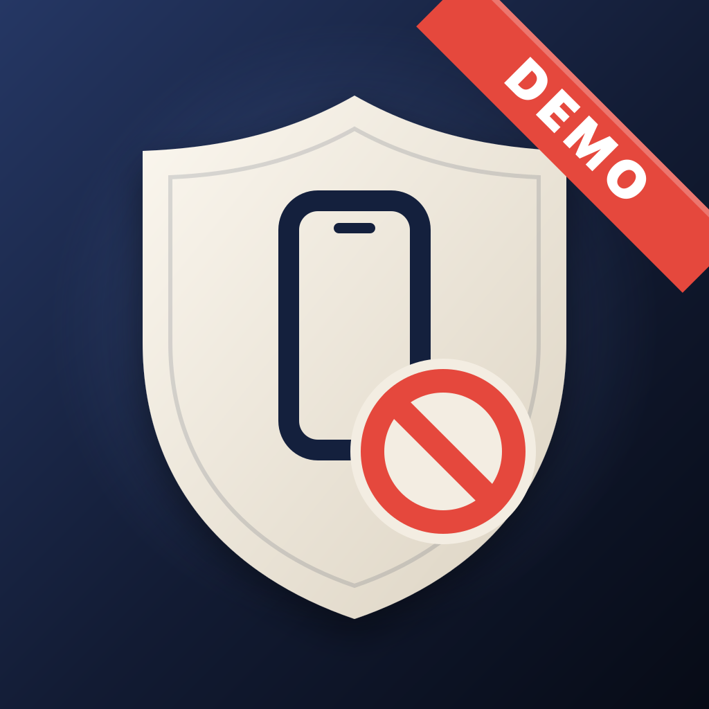

<p align="center">
  
</p>

# NonGrata Demo

A small SwiftUI app to see NonGrata working end to end on a real iPhone: ban the device from the
terminal, watch the suspended screen appear, erase the list, reinstall, unban with the support
code, go offline.

It shows the current verdict, the support code, the device's `installId` and `idfv`, the exact
`pnpm ng` commands to ban and unban this device, a button for each kind of check, a DeviceCheck
diagnostic and a history of checks. It uses `NonGrataUI`'s suspended screen.

## Run it

You need Xcode, [XcodeGen](https://github.com/yonaskolb/XcodeGen), a real iPhone (DeviceCheck
doesn't work in the Simulator) and a deployed Worker (see the [Quick start](../../README.md#quick-start)).
For the demo, deploy a separate Worker with app `demo`, `HASH_PREFIX_DEMO = "demo-ban-v1"` and
`ENFORCE_DEMO = "true"`, so bans are actually enforced.

1. Register an **explicit App ID** for the demo's bundle ID in your team (Certificates, IDs &
   Profiles → Identifiers, no capabilities). Without it Apple rejects the DeviceCheck calls and
   the Worker decides with its list only ([why](../../docs/INTEGRATION-IOS.md)).
2. Configure your values:
   ```sh
   cd Examples/NonGrataDemo
   cp Config/Local.example.xcconfig Config/Local.xcconfig   # git ignores it
   ```
   Fill in your Team ID, the bundle ID you registered and your Worker's check URL.
3. Generate the project and run it on your iPhone:
   ```sh
   xcodegen generate
   open NonGrataDemo.xcodeproj
   ```

The DeviceCheck key must belong to the same team that signs the app.

## Try it

From the repo root, with `NONGRATA_URL_DEMO` and `NONGRATA_ADMIN_TOKEN_DEMO` in your environment
(tap the rows in the app to copy the commands):

| Step | Do | Expect |
|---|---|---|
| 1 | `pnpm ng ban app=demo kind=install value=<installId>` and reopen the app | Suspended screen with a support code. The Worker adds the device's other identifiers and sets `bit0` at Apple. |
| 2 | Empty the list (`DELETE FROM banned_ids` in D1) and reopen | Still blocked: `bit0` lives on Apple's servers. |
| 3 | Delete the app, reinstall, open | Blocked from the first launch: the `installId` survives in the Keychain and `bit0` at Apple. |
| 4 | `pnpm ng unban app=demo ref=<code>` and reopen | Allowed. `bit0` goes back to 0 and the identifiers leave the list. |
| 5 | Airplane mode **and** Wi-Fi off, open | No local flag: `unknown`, the app opens (fail-open). "Check: sign-up" is refused (strict mode). |
| 6 | Ban again with network, then go offline and reopen | Still blocked: the SDK keeps the block flag on the device. |

When you finish, unban the device: `bit0` is per device and per team, so it would also affect
your other apps that use NonGrata with the same key.

The app prints each check to the console (`[NonGrataDemo] check launch: …`), so you can follow it
with `xcrun devicectl device process launch --console`.

## License

[MIT](../../LICENSE).
