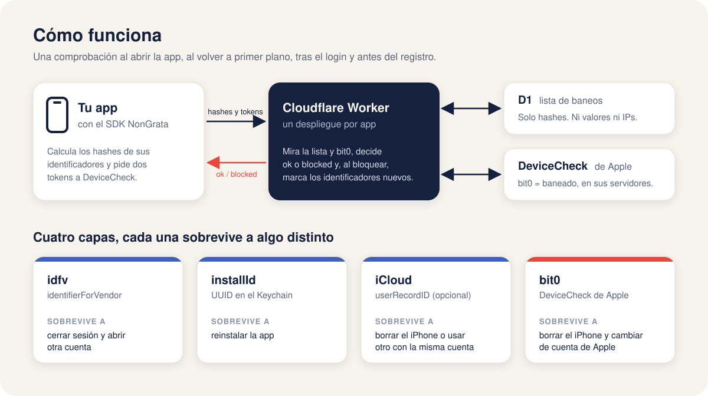

<p align="center">
  
</p>

<h1 align="center">NonGrata</h1>

<p align="center">
  <strong>Baneo por dispositivo y por cuenta de Apple para apps iOS.</strong><br>
  Quien ya no es bienvenido no vuelve a entrar, aunque reinstale, cree otra cuenta o borre el iPhone.
</p>

<p align="center">
  
  
  
  
  <a href="https://github.com/WilderLopez/nongrata/tags"></a>
  <a href="LICENSE"></a>
</p>

<p align="center">
  <a href="#cómo-funciona">Cómo funciona</a> ·
  <a href="#inicio-rápido">Inicio rápido</a> ·
  <a href="#uso-en-la-app">Uso en la app</a> ·
  <a href="#administración">Administración</a> ·
  <a href="#documentación">Documentación</a>
</p>

---

## El problema

Alguien abusa de tu app, lo baneas y a los dos días vuelve con otra cuenta. Cierra sesión y abre
otra, reinstala la app, borra el iPhone. Banear la cuenta no basta, y la IP o el correo tampoco
sirven: las IPs las comparten cientos de usuarios de un mismo operador y los correos son
desechables.

NonGrata recuerda **el dispositivo y la cuenta de Apple**, con varias capas que sobreviven a cosas
distintas. La más fuerte son los dos bits de
[DeviceCheck](https://developer.apple.com/documentation/devicecheck) que Apple guarda en sus
servidores para cada dispositivo, y que siguen ahí incluso después de borrar el iPhone.

## Cómo funciona

<p align="center">
  
</p>

Son cuatro piezas en un mismo repo:

| Pieza | Qué hace |
|---|---|
| **SDK Swift** (`NonGrata`) | Reúne los identificadores, los convierte en hashes y pregunta al Worker. Recuerda el veredicto aunque no haya red. |
| **Pantalla opcional** (`NonGrataUI`) | La pantalla de "Acceso suspendido" con el código de soporte, en español e inglés. |
| **Worker** (`worker/`) | Un Cloudflare Worker con D1 por app. Decide con su lista y con DeviceCheck. |
| **CLI** (`cli/`) | Banear, desbanear y consultar desde la terminal. |

## Por qué así

- **Privado por diseño.** Solo viajan hashes (`SHA256(prefijo:tipo:valor)`). Ni el Worker ni la
  base guardan identificadores en bruto ni IPs, y el uso antifraude no es tracking: no hace falta
  pedir el permiso de ATT.
- **Fail-open.** Si la red o Apple fallan, el usuario entra. Nadie se queda fuera por un error
  del sistema. La excepción es crear una cuenta: con el modo estricto (`strictSignup`, activado
  por defecto) el registro exige una respuesta del Worker.
- **Modo observación.** Al desplegar, el Worker solo registra lo que bloquearía. Revisas los datos
  y activas el bloqueo cuando te fíes, sin publicar otra versión de la app.
- **Se propaga solo.** Cuando un dispositivo sale bloqueado, el Worker añade sus identificadores
  nuevos a la lista. Con `useICloud`, si el actor usa la misma cuenta de Apple en otro iPhone,
  también cae.
- **Desbaneo con un código.** El usuario ve un código de soporte de 8 caracteres. Con él lo
  desbaneas por completo desde la terminal.
- **Sin servidores que mantener.** Cloudflare Workers y D1; el plan gratuito sobra para empezar.
- **Independiente de tu backend.** No hay que tocar el servidor de la app.
- **Probado a fondo.** Tests en los tres componentes y mutation testing con Stryker: Worker
  99,5 % y CLI 100 % de mutantes muertos.

## La pantalla de suspendido

<p align="center">
  
</p>

Es opcional: si prefieres la tuya, lee `nonGrata.verdict`. La de `NonGrataUI` cubre la app solo
cuando hay un bloqueo, se retira sola al desbanear, deja copiar el código y funciona con
VoiceOver y Dynamic Type.

## Requisitos

| | |
|---|---|
| App | iOS 17 o superior, Swift 6 |
| Servidor | Una cuenta de Cloudflare (Workers y D1) |
| Apple | Una clave con DeviceCheck activado, del portal de Apple Developer (Certificates, IDs & Profiles → Keys) |
| Opcional | iCloud con CloudKit y key-value storage en el App ID, para la capa de iCloud (`useICloud`) |
| Desarrollo | Node 22.18 o superior, pnpm y Xcode |

## Inicio rápido

### 1. Despliega el Worker de tu app

```sh
git clone https://github.com/WilderLopez/nongrata.git && cd nongrata
make install
cp -r deployments/example deployments/<tu-app>      # git ignora esta carpeta
cd worker
pnpm exec wrangler d1 create nongrata-<tu-app>       # copia el database_id a tu wrangler.jsonc
```

Edita `deployments/<tu-app>/wrangler.jsonc` (nombre, `HASH_PREFIX_<APP>`, Team ID y Key ID) y,
desde `worker/`:

```sh
pnpm exec wrangler d1 migrations apply DB --remote --config ../deployments/<tu-app>/wrangler.jsonc
pnpm exec wrangler secret put ADMIN_TOKEN --config ../deployments/<tu-app>/wrangler.jsonc
pnpm exec wrangler secret put APPLE_DC_KEY_P8_<APP> --config ../deployments/<tu-app>/wrangler.jsonc < AuthKey_<KEY_ID>.p8
pnpm exec wrangler deploy --config ../deployments/<tu-app>/wrangler.jsonc
```

Arranca en modo observación (`ENFORCE_<APP> = "false"`). Más detalle en
[Cloudflare Worker y D1](docs/conceptos/cloudflare-worker-y-d1.md).

### 2. Añade el paquete

En Xcode: **File → Add Package Dependencies…** con `https://github.com/WilderLopez/nongrata.git`,
desde `0.1.0`. O en tu `Package.swift`:

```swift
.package(url: "https://github.com/WilderLopez/nongrata.git", from: "0.1.0")
```

Productos: `NonGrata` (obligatorio) y `NonGrataUI` (la pantalla, opcional).

## Uso en la app

```swift
import SwiftUI
import NonGrata
import NonGrataUI

@main
struct MyApp: App {
    @State private var nonGrata = NonGrata(configuration: .init(
        endpoint: URL(string: "https://nongrata-myapp.<tu-subdominio>.workers.dev/v1/device/check")!,
        appId: "myapp",
        hashPrefix: "myapp-ban-v1"   // igual que HASH_PREFIX_MYAPP del Worker
    ))
    @Environment(\.scenePhase) private var scenePhase

    var body: some Scene {
        WindowGroup {
            ContentView()
                .nonGrataBlockingOverlay(nonGrata) { ref in
                    Link("Contactar con soporte",
                         destination: URL(string: "mailto:soporte@example.com?subject=\(ref)")!)
                }
                .task { await nonGrata.check(intent: .launch) }
        }
        .onChange(of: scenePhase) { _, fase in
            if fase == .active { Task { await nonGrata.check(intent: .foreground) } }
        }
    }
}
```

Tras el login, `check(intent: .login, userId: user.id)`. Antes de crear una cuenta:

```swift
let verdict = await nonGrata.check(intent: .signup)
guard nonGrata.permits(verdict, for: .signup) else { return }   // bloqueado o, en estricto, sin respuesta
createAccount()
```

Todo lo demás (capacidades, Keychain, analítica, privacidad en App Store Connect) está en
[Integrar en una app iOS](docs/INTEGRATION-IOS.md).

## Administración

```sh
export NONGRATA_URL_MYAPP=https://nongrata-myapp.<tu-subdominio>.workers.dev
export NONGRATA_ADMIN_TOKEN_MYAPP=<tu ADMIN_TOKEN>

pnpm ng ban    app=myapp kind=idfv value=<IDFV> note="spam"
pnpm ng lookup app=myapp ref=7F3A9C21     # qué se sabe de ese código de soporte
pnpm ng unban  app=myapp ref=7F3A9C21     # desbaneo completo en su próxima comprobación
pnpm ng hash   prefix=myapp-ban-v1 kind=idfv value=<IDFV>   # el hash, sin red
```

## Lo que no hace

- **No impide que alguien modifique la app** para saltarse la comprobación. App Attest cerraría
  ese hueco y está previsto como opcional.
- **No es un antifraude completo.** Es un muro para quien ya has decidido banear; detectar a
  quién banear es cosa tuya.
- **No funciona en el simulador** la parte de DeviceCheck: hay que probar en un iPhone.
- **Android** está esbozado en el diseño, no implementado.

## Documentación

- [Diseño completo](docs/HANDOFF.md): el problema, la arquitectura, el contrato, el algoritmo,
  los riesgos y lo que queda por verificar.
- [Integrar en una app iOS](docs/INTEGRATION-IOS.md).
- Conceptos: [identificadores](docs/conceptos/identificadores.md),
  [DeviceCheck](docs/conceptos/devicecheck.md), [hash y ref](docs/conceptos/hash-y-ref.md),
  [flujo de una comprobación](docs/conceptos/flujo-de-check.md),
  [propagación](docs/conceptos/propagacion.md),
  [fail-open y modo observación](docs/conceptos/fail-open-y-observacion.md) y el
  [glosario](docs/glosario.md).

## Desarrollo

```sh
make install   # dependencias (solo pnpm)
make check     # documentación, tipos, tests de Worker, CLI y SDK, build de iOS y mutation testing
```

Los tests del Worker corren dentro de `workerd` y no llaman a Apple; los de Swift, con
`swift test` desde la raíz. Antes de dar algo por terminado, `make check` tiene que quedar en
verde.

## Licencia

[MIT](LICENSE). El nombre viene de *persona non grata*: alguien que ya no es bienvenido.
