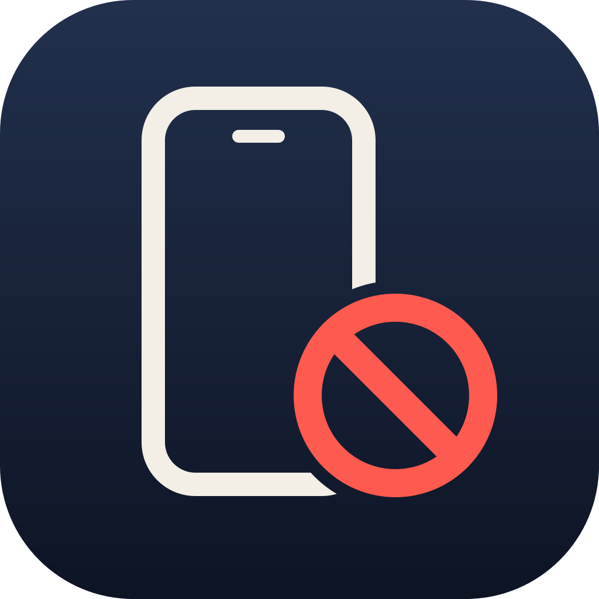
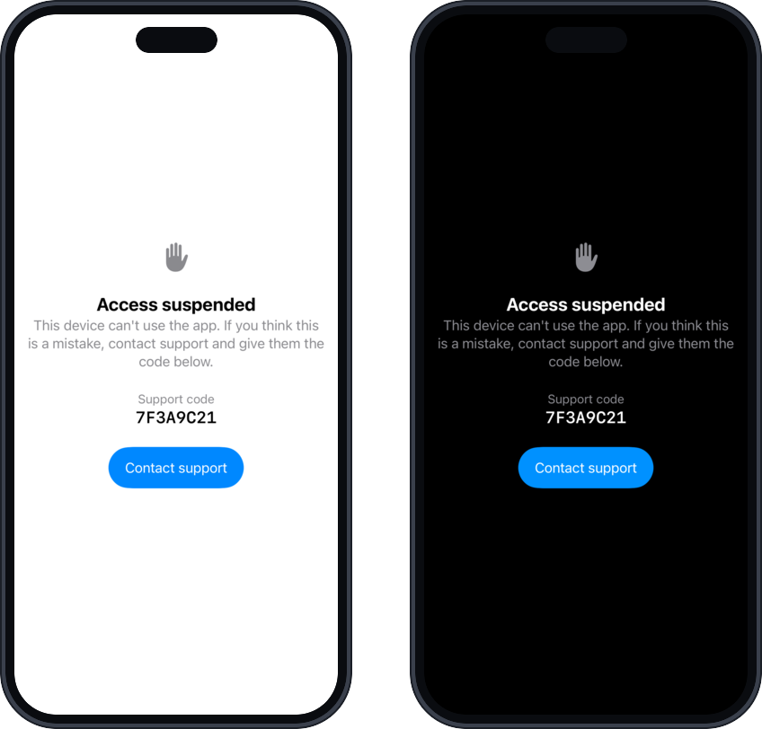

<p align="center">
  
</p>

<h1 align="center">NonGrata</h1>

<p align="center"><strong>English</strong> · <a href="README.es.md">Español</a></p>

<p align="center">
  <strong>Device and Apple Account bans for iOS apps.</strong><br>
  Once someone is no longer welcome, they stay out, even if they reinstall, create another account or erase the iPhone.
</p>

<p align="center">
  
  
  
  
  <a href="https://github.com/WilderLopez/nongrata/tags"></a>
  <a href="LICENSE"></a>
</p>

<p align="center">
  <a href="#how-it-works">How it works</a> ·
  <a href="#quick-start">Quick start</a> ·
  <a href="#using-it-in-your-app">Using it in your app</a> ·
  <a href="#administration">Administration</a> ·
  <a href="#documentation">Documentation</a>
</p>

---

## The problem

Someone abuses your app, you ban them, and two days later they are back with a new account. They
sign out and create another one, reinstall the app, erase the iPhone. Banning the account is not
enough, and IP addresses or emails don't help either: hundreds of users share a carrier's IPs, and
email addresses are disposable.

NonGrata remembers **the device and the Apple Account**, using several layers that each survive
something different. The strongest one is the two bits of
[DeviceCheck](https://developer.apple.com/documentation/devicecheck) that Apple stores on its
servers for every device, which are still there after the iPhone is erased.

## How it works

<p align="center">
  
</p>

Four pieces in one repo:

| Piece | What it does |
|---|---|
| **Swift SDK** (`NonGrata`) | Collects the identifiers, hashes them and asks the Worker. Remembers the verdict even without a network. |
| **Optional screen** (`NonGrataUI`) | The "Access suspended" screen with the support code, in English and Spanish. |
| **Worker** (`worker/`) | A Cloudflare Worker with D1, one per app. Decides using its list and DeviceCheck. |
| **CLI** (`cli/`) | Ban, unban and look up from the terminal. |

## Why it works this way

- **Private by design.** Only hashes travel (`SHA256(prefix:kind:value)`). Neither the Worker nor
  the database stores raw identifiers or IP addresses, and anti-fraud use is not tracking: no
  App Tracking Transparency prompt is needed.
- **Fail-open.** If the network or Apple fails, the user gets in. Nobody is locked out by a
  system error. The exception is account creation: with strict mode (`strictSignup`, on by
  default) sign-up requires an answer from the Worker.
- **Observation mode.** After deploying, the Worker only records what it would block. You review
  the data and turn blocking on when you trust it, without shipping a new app version.
- **Self-propagating.** When a device is blocked, the Worker adds its new identifiers to the list.
  With `useICloud`, if the same Apple Account shows up on another iPhone, that one is caught too.
- **Unban with a code.** The user sees an 8-character support code. With it you lift the ban
  completely from the terminal.
- **No servers to run.** Cloudflare Workers and D1; the free plan is plenty to start.
- **Independent of your backend.** Your app's server doesn't change.
- **Thoroughly tested.** Tests in all three components, plus mutation testing with Stryker: 99.5%
  of mutants killed in the Worker and 100% in the CLI.

## The suspended screen

<p align="center">
  
</p>

It is optional: if you prefer your own, read `nonGrata.verdict`. The `NonGrataUI` one covers the
app only while there is a ban, goes away by itself after an unban, lets the user copy the code,
and works with VoiceOver and Dynamic Type.

## Requirements

| | |
|---|---|
| App | iOS 17 or later, Swift 6 |
| Server | A Cloudflare account (Workers and D1) |
| Apple | A key with DeviceCheck enabled, from the Apple Developer portal (Certificates, IDs & Profiles → Keys) |
| Optional | iCloud with CloudKit and key-value storage on the App ID, for the iCloud layer (`useICloud`) |
| Development | Node 22.18 or later, pnpm and Xcode |

## Quick start

### 1. Deploy your app's Worker

```sh
git clone https://github.com/WilderLopez/nongrata.git && cd nongrata
make install
cp -r deployments/example deployments/<your-app>    # git ignores this folder
cd worker
pnpm exec wrangler d1 create nongrata-<your-app>     # copy the database_id into your wrangler.jsonc
```

Edit `deployments/<your-app>/wrangler.jsonc` (name, `HASH_PREFIX_<APP>`, Team ID and Key ID) and,
from `worker/`:

```sh
pnpm exec wrangler d1 migrations apply DB --remote --config ../deployments/<your-app>/wrangler.jsonc
pnpm exec wrangler secret put ADMIN_TOKEN --config ../deployments/<your-app>/wrangler.jsonc
pnpm exec wrangler secret put APPLE_DC_KEY_P8_<APP> --config ../deployments/<your-app>/wrangler.jsonc < AuthKey_<KEY_ID>.p8
pnpm exec wrangler deploy --config ../deployments/<your-app>/wrangler.jsonc
```

It starts in observation mode (`ENFORCE_<APP> = "false"`). More in
[Cloudflare Worker and D1](docs/concepts/cloudflare-worker-and-d1.md).

### 2. Add the package

In Xcode: **File → Add Package Dependencies…** with `https://github.com/WilderLopez/nongrata.git`,
from `0.2.0`. Or in your `Package.swift`:

```swift
.package(url: "https://github.com/WilderLopez/nongrata.git", from: "0.2.0")
```

Products: `NonGrata` (required) and `NonGrataUI` (the screen, optional).

### 3. See it working

[`Examples/NonGrataDemo`](Examples/NonGrataDemo/README.md) is a small app to try the whole flow
on a real iPhone: ban it from the terminal, erase the list, reinstall, unban with the support
code and go offline.

## Using it in your app

```swift
import SwiftUI
import NonGrata
import NonGrataUI

@main
struct MyApp: App {
    @State private var nonGrata = NonGrata(configuration: .init(
        endpoint: URL(string: "https://nongrata-myapp.<your-subdomain>.workers.dev/v1/device/check")!,
        appId: "myapp",
        hashPrefix: "myapp-ban-v1"   // same as the Worker's HASH_PREFIX_MYAPP
    ))
    @Environment(\.scenePhase) private var scenePhase

    var body: some Scene {
        WindowGroup {
            ContentView()
                .nonGrataBlockingOverlay(nonGrata) { ref in
                    Link("Contact support",
                         destination: URL(string: "mailto:support@example.com?subject=\(ref)")!)
                }
                .task { await nonGrata.check(intent: .launch) }
        }
        .onChange(of: scenePhase) { _, phase in
            if phase == .active { Task { await nonGrata.check(intent: .foreground) } }
        }
    }
}
```

After login, `check(intent: .login, userId: user.id)`. Before creating an account:

```swift
let verdict = await nonGrata.check(intent: .signup)
guard nonGrata.permits(verdict, for: .signup) else { return }   // blocked or, in strict mode, no answer
createAccount()
```

Everything else (capabilities, Keychain, analytics, App Store Connect privacy) is in
[Integrating into an iOS app](docs/INTEGRATION-IOS.md).

## Administration

```sh
export NONGRATA_URL_MYAPP=https://nongrata-myapp.<your-subdomain>.workers.dev
export NONGRATA_ADMIN_TOKEN_MYAPP=<your ADMIN_TOKEN>

pnpm ng ban    app=myapp kind=idfv value=<IDFV> note="spam"
pnpm ng lookup app=myapp ref=7F3A9C21     # what is known about that support code
pnpm ng unban  app=myapp ref=7F3A9C21     # full unban on the device's next check
pnpm ng hash   prefix=myapp-ban-v1 kind=idfv value=<IDFV>   # the hash, offline
```

## What it doesn't do

- **It doesn't stop someone from modifying the app** to skip the check. App Attest would close
  that gap and is planned as an option.
- **It isn't a full anti-fraud system.** It is a wall for people you have already decided to ban;
  finding who to ban is up to you.
- **The DeviceCheck part doesn't work in the Simulator**: test on a real iPhone.
- **Android** is sketched in the design, not implemented.

## Documentation

- [Full design](docs/DESIGN.md): the problem, architecture, contract, algorithm, risks and what
  is still to be verified.
- [Integrating into an iOS app](docs/INTEGRATION-IOS.md).
- Concepts: [identifiers](docs/concepts/identifiers.md),
  [DeviceCheck](docs/concepts/devicecheck.md), [hash and ref](docs/concepts/hash-and-ref.md),
  [check flow](docs/concepts/check-flow.md), [propagation](docs/concepts/propagation.md),
  [fail-open and observation mode](docs/concepts/fail-open-and-observation.md) and the
  [glossary](docs/glossary.md).
- All docs are also available [in Spanish](docs/es/DISENO.md).

## Development

```sh
make install   # dependencies (pnpm only)
make check     # docs, types, Worker, CLI and SDK tests, iOS build and mutation testing
```

The Worker tests run inside `workerd` and never call Apple; the Swift tests run with `swift test`
from the repo root. `make check` must be green before anything is considered done.

## License

[MIT](LICENSE). The name comes from *persona non grata*: someone who is no longer welcome.
