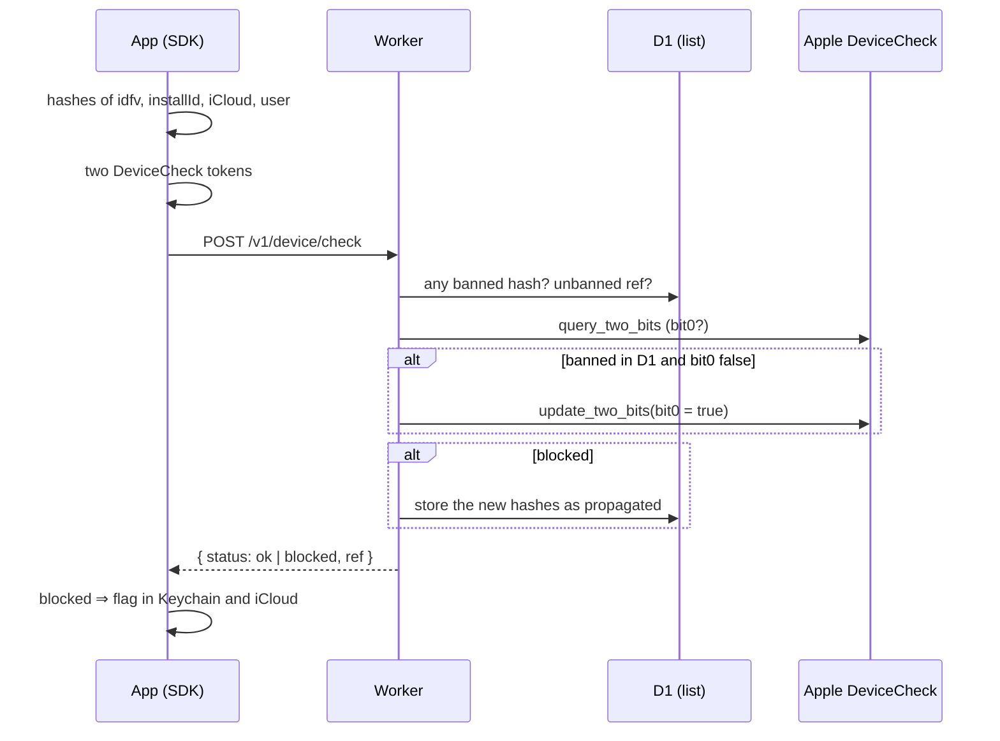

# Check flow

*Español: [flujo-de-check.md](../es/conceptos/flujo-de-check.md)*

What happens every time the app calls `nonGrata.check(intent:)`. It is the heart of the system;
the other notes explain each piece.

## Step by step

1. **The SDK gathers identifiers** and turns them into hashes. They never leave the iPhone raw.
   See [Identifiers](identifiers.md) and [Hash and ref](hash-and-ref.md).
2. **It asks Apple for two DeviceCheck tokens**: one to query and one to write. See
   [DeviceCheck](devicecheck.md).
3. **The Worker looks at the list in D1**: whether any hash is banned, or whether support
   scheduled an unban for that `ref`.
4. **The Worker asks Apple** for the device's `bit0`.
5. **It decides**: blocked if there is a banned hash or if `bit0` is true. If it was banned in
   D1 but `bit0` isn't set yet, it writes it at Apple so it survives reinstalls. In observation
   mode it neither writes nor propagates (steps 5 and 6): it only logs.
6. **It propagates**: if it blocks, it stores the request's new hashes. See
   [Propagation](propagation.md).
7. **It responds** `ok` or `blocked`, except in observation mode. See
   [Fail-open and observation mode](fail-open-and-observation.md).

## Where it is in the code

- SDK: `swift/Sources/NonGrata/NonGrata.swift` (`check`, `performCheck`, `apply`).
- Worker: `worker/src/check.ts` (`runCheck`); the SQL in `worker/src/store.ts`; Apple in
  `worker/src/apple/`.
- Design: section 6.1 of [DESIGN.md](../DESIGN.md).
