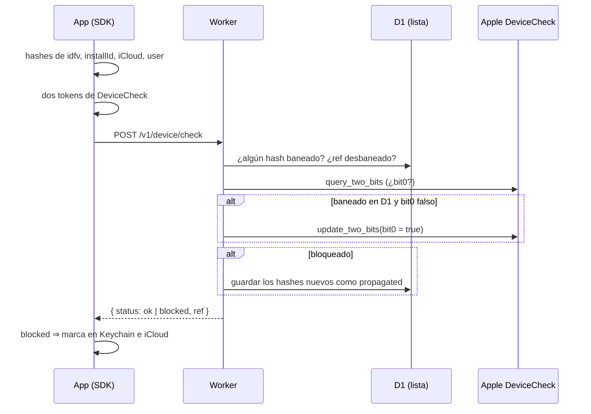

# Flujo de una comprobación

*English: [check-flow.md](../../concepts/check-flow.md)*

Lo que pasa cada vez que la app llama a `nonGrata.check(intent:)`. Es el corazón del sistema;
el resto de notas explica cada pieza.

## Paso a paso

1. **El SDK reúne identificadores** y los convierte en hashes. Nunca salen en bruto del iPhone.
   Ver [Identificadores](identificadores.md) y [Hash y ref](hash-y-ref.md).
2. **Pide a Apple dos tokens de DeviceCheck**: uno para consultar y otro para escribir. Ver
   [DeviceCheck](devicecheck.md).
3. **El Worker mira la lista en D1**: si algún hash está baneado, o si soporte programó un
   desbaneo para ese `ref`.
4. **El Worker pregunta a Apple** por `bit0` del dispositivo.
5. **Decide**: bloqueado si hay un hash baneado o si `bit0` es verdadero. Si estaba baneado en
   D1 pero `bit0` aún no, lo escribe en Apple para que sobreviva a reinstalar. En modo
   observación no escribe ni propaga (pasos 5 y 6): solo registra.
6. **Propaga**: si bloquea, guarda los hashes nuevos de esa petición. Ver
   [Propagación](propagacion.md).
7. **Responde** `ok` o `blocked`, salvo en modo observación. Ver
   [Fail-open y modo observación](fail-open-y-observacion.md).

## Dónde está en el código

- SDK: `swift/Sources/NonGrata/NonGrata.swift` (`check`, `performCheck`, `apply`).
- Worker: `worker/src/check.ts` (`runCheck`); el SQL en `worker/src/store.ts`; Apple en
  `worker/src/apple/`.
- Diseño: sección 6.1 de [DISENO.md](../DISENO.md).
